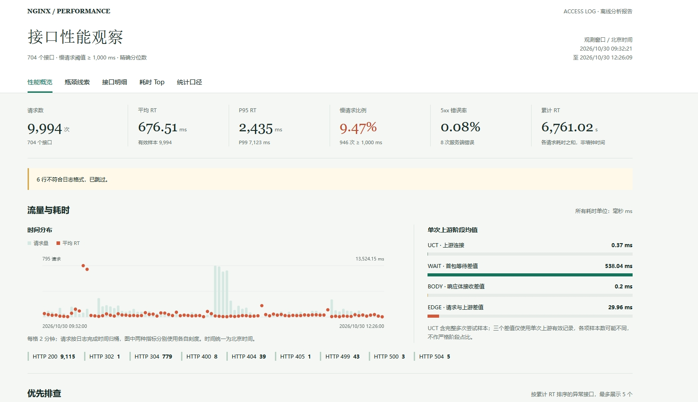
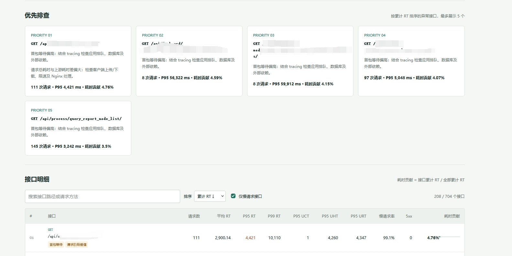

# Nginx 接口性能分析

使用 Node.js 将 nginx的日志 access log 转为美化的、可搜索排序的离线 HTML 报告，辅助定位上游连接、首包等待和响应传输瓶颈。也支持持续监控新增日志，并通过飞书机器人或 SMTP 邮件发送慢请求告警。离线分析无需安装依赖、不上传日志、不加载 CDN；启用邮件告警需先安装依赖。

## 快速开始

需要 Node.js 20 或更高版本。

```bash
# 分析一个文件
node analyze.mjs /var/log/nginx/access.log -o report.html

# 生成当前示例的报告
npm run demo

# 合并轮转文件，设置 500 ms 慢请求阈值，同时导出 JSON
node analyze.mjs access.log.2.gz access.log.1 access.log \
  --slow-ms 500 --top 30 -o reports/nginx.html --json reports/stats.json

# 从标准输入读取；与文件输入一样，报告仍输出到指定文件
cat /var/log/nginx/access.log | node analyze.mjs - -o report.html

# 将 /api/users/123、/api/users/456 合并为 /api/users/:id
node analyze.mjs access.log --normalize-ids

# 接口明细也包含 JS、CSS 等静态资源
node analyze.mjs access.log --include-static

# 运行测试
npm test
```

直接在浏览器打开生成的 HTML，无需启动服务器。输入路径中的通配符由 shell 展开，例如 `node analyze.mjs /var/log/nginx/access.log*`。不要同时传入相互重叠的日志，工具不做请求去重。

| 参数 | 默认值 | 说明 |
| --- | --- | --- |
| `-o, --output` | `report.html` | HTML 路径，自动创建父目录 |
| `--json` | 不输出 | 额外保存结构化统计数据 |
| `--slow-ms` | `1000` | 慢请求阈值，毫秒，包含等于阈值的请求 |
| `--top` | `20` | 保留耗时最高的请求条数，不限于慢请求 |
| `--normalize-ids` | 关闭 | 将完整数字和 UUID 路径段替换为 `:id` |
| `--include-static` | 关闭 | 接口明细及优先排查包含静态资源，默认忽略 |
| `-h, --help` | | 查看帮助 |

## 持续监控与告警

```bash
# 默认从文件末尾监听，RT >= 10 秒时在终端输出告警
node analyze.mjs /var/log/nginx/access_timing.log --watch --alert-ms 10000

# 同时监控多个文件，阈值 5 秒，同文件同接口每 60 秒最多告警一次
node analyze.mjs access_timing.log other.log --watch \
  --alert-ms 5000 --alert-cooldown-ms 60000 --poll-ms 1000
```

| 监控参数 | 默认值 | 说明 |
| --- | --- | --- |
| `--watch` | 关闭 | 持续监听普通文件，不读取历史数据，不生成 HTML / JSON |
| `--alert-ms` | `10000` | 按 `rt=$request_time` 判断，单位毫秒，包含等于阈值 |
| `--alert-cooldown-ms` | `60000` | 按日志文件 + HTTP 方法 + 去掉查询参数的路径限频；`0` 每条都通知 |
| `--poll-ms` | `1000` | 文件轮询间隔，正整数毫秒 |
| `--feishu-webhook` | `FEISHU_WEBHOOK_URL` 环境变量 | 飞书自定义机器人 Webhook |
| `--email-to` | `ALERT_EMAIL_TO` 环境变量 | 邮件收件人，多个地址用逗号分隔 |

告警参数必须与 `--watch` 一起使用。监控不支持 stdin、`.gz` 和报告选项（`--output`、`--json`、`--slow-ms`、`--top`、`--normalize-ids`、`--include-static`）；包含静态资源在内的所有有效请求都参与告警。缺失或非法 RT、格式错误的行不会触发通知。

### 飞书机器人

创建群自定义机器人，将 Webhook 和可选签名密钥设置到部署环境。推荐环境变量，避免 Webhook 出现在进程参数中。

```bash
export FEISHU_WEBHOOK_URL='https://open.feishu.cn/open-apis/bot/v2/hook/替换为机器人标识'
# 仅在机器人启用签名校验时设置
export FEISHU_SECRET='替换为签名密钥'
node analyze.mjs /var/log/nginx/access_timing.log --watch --alert-ms 10000
```

若配置关键词校验，请允许 `Nginx`；如开启 IP 白名单，应允许监控机器的出口 IP。支持机器人签名，检查 HTTP 状态和飞书业务返回码；发送失败会输出错误，不中断监控。

### SMTP 邮件

```bash
npm ci
export SMTP_HOST='smtp.example.com'
export SMTP_PORT='465'
export SMTP_SECURE='true'
export SMTP_USER='monitor@example.com'
export SMTP_PASS='替换为 SMTP 密码或授权码'
export SMTP_FROM='monitor@example.com'
export ALERT_EMAIL_TO='ops@example.com,dev@example.com'
node analyze.mjs /var/log/nginx/access_timing.log --watch --alert-ms 10000
```

`SMTP_HOST`、`SMTP_FROM` 和收件人必填，认证账号 `SMTP_USER` / `SMTP_PASS` 必须成对设置，无认证的内部中继可省略。`SMTP_PORT` 默认 `465`，`SMTP_SECURE` 默认在 465 端口为 `true`（连接即 TLS），其他端口为 `false`（默认要求 STARTTLS）。587 端口通常设置 `SMTP_PORT=587`、`SMTP_SECURE=false`。默认验证 TLS 证书；仅可信内部明文中继可显式设置 `SMTP_REQUIRE_TLS=false`，不要用于公网凭据传输。

飞书和邮件可同时启用，渠道独立发送，一个失败不影响另一个；无论是否配置外部渠道，告警都输出到终端。通知包含主机、日志路径、接口、RT、阈值、状态码及请求完成时间，不包含 IP、查询参数、Referer、UA 或原始日志行。

### 运行边界

- Nginx access log 通常在请求结束后才落盘。因此这是**已完成慢请求告警**，无法在请求尚未返回时检测“已等待 10 秒”；通知延迟还受日志缓冲、轮询间隔和通知耗时影响。
- 按 UTF-8 / CRLF 处理，只消费以换行符结束的完整行；启动前已存在的不完整行也会跳过。超过 1 MiB 的未完成行丢弃，避免无界内存增长。
- 支持 rename 后创建新文件的轮转（补读旧文件当前尾部，新文件从头读取），以及观察到文件变小的截断；轮转期间路径短暂不存在时继续等待。无法保证读取关闭旧句柄后仍写入旧文件的数据，也无法识别两次轮询之间截断后已长回原大小的 copytruncate。
- 启动时文件必须存在且可读；其他文件读取错误会退出。Ctrl+C / SIGTERM 会关闭文件和邮件资源；正在发送的网络通知可能需等待超时，HTTP 和 SMTP 均配置了 10 秒超时。
- 通知采用尽力发送，不持久化、不自动重试；失败的请求也计入冷却期，避免故障时反复轰炸。重启后从当前文件末尾开始，停机期间的日志不会补发；建议用 systemd / 容器运行并收集终端错误。
- 不积累报表样本，内存主要用于文件读取缓冲和冷却期内的独立接口记录。通知串行处理请求、并行发送渠道；大量不同接口同时变慢或通知服务迟缓时可能出现读取积压，严格不漏告警的场景应使用持久化日志采集和消息队列。

## 日志格式

支持问题中使用的 ISO 8601 时间与以下格式，末尾四个计时字段可调整顺序，也可缺失。前缀结构需要一致，不支持未经修改的其他 combined 格式或 JSON 日志。

```nginx
log_format timings '$remote_addr [$time_iso8601] '
                   '"$request" $status $body_bytes_sent '
                   '"$http_referer" "$http_user_agent" '
                   'rt=$request_time uct="$upstream_connect_time" '
                   'uht="$upstream_header_time" urt="$upstream_response_time"';

access_log /var/log/nginx/access_timing.log timings;
```

日志中的耗时单位是秒，报告统一换算为毫秒。支持 UTF-8 / CRLF、普通文本和 `.gz` 文件；格式错误的行跳过并计数。没有有效请求时返回非零退出码，不生成报告。

## 报告内容

- 总请求量、接口数、平均耗时、P95/P99、慢请求比例、5xx 错误率和累计耗时。
- RT、UCT、UHT、URT 及派生差值的样本数、缺失数、均值、最小值、P50/P90/P95/P99、最大值。
- 按 HTTP 方法 + 去掉查询参数的原始路径聚合；接口表支持搜索、慢接口过滤和排序。
- 按累计 RT 贡献排序的优先排查接口，以及请求耗时 Top 明细。
- 完成时间流量图、平均耗时、阶段均值、状态码分布、重试及异常数据质量。

### 报告示意

以下截图展示报告效果，数据不对应下文的 10 条示例日志。

**性能概览**：集中查看请求量、平均 RT、P95、慢请求比例和 5xx 错误率，结合时间分布与上游阶段均值观察性能变化。



**优先排查与接口明细**：按累计 RT 展示异常接口及排查建议；明细表支持路径或请求方法搜索、指标排序和仅慢请求接口过滤。



### 指标含义

| 指标 | 含义 | 排查方向 |
| --- | --- | --- |
| RT | Nginx 整个请求的耗时 | 客户端收发、Nginx、上游共同影响 |
| UCT | 建立上游连接的耗时，HTTPS 含握手 | 网络、连接复用、TLS、连接队列 |
| UHT | 从上游计时开始到收到响应头 | 包含连接阶段，不能当作纯应用耗时 |
| URT | 收到上游响应的耗时 | 包含连接及响应头阶段 |
| UHT − UCT | 近似首包等待差值 | 应用排队、数据库或外部依赖，需 tracing 验证 |
| URT − UHT | 近似响应体接收差值 | 大响应、流式输出、上游传输 |
| RT − URT | 请求总耗时与上游耗时差 | 客户端上传/下载、代理处理或限速等 |

**UCT、UHT、URT 存在包含关系，不应直接相加。仅凭 access log 不能区分数据库、CPU、锁等待或第三方服务耗时，也不能精确重建网络与应用阶段。**

### 统计口径

- 接口明细和优先排查默认忽略静态资源，可通过 `--include-static` 恢复。按去掉查询参数后的路径扩展名匹配，不区分大小写：JS/MJS/CJS、CSS、MAP、HTML/HTM、PNG/JPG/JPEG/GIF/SVG/ICO/WEBP/AVIF/BMP/TIF/TIFF、WOFF/WOFF2/TTF/OTF/EOT、MP3/MP4/WEBM/OGG/WAV、PDF。总体指标、时间趋势、数据质量及请求耗时 Top 仍包含全部有效请求；耗时贡献的分母仍为全部累计 RT。
- 分位数采用精确的 nearest-rank：排序后取第 `ceil(n × p)` 个观测值。缺失值不参与统计，也不填零；不同指标的样本量可能不同。
- 慢请求率的分母为有效 RT 数；5xx / 4xx 比例的分母为有效请求数。4xx 不并入服务端错误率。
- 多次上游尝试（`0.001, 0.002`）和内部重定向组（`0.001 : 0.002`）逐项求和。某个计时列表含 `-` 或非法值时，该项整体视为缺失，避免低估；多次尝试不计算阶段差值。
- 单次尝试的负差在 2 ms 容差内归零，超过容差时该差值排除并标记时序异常；原始计时仍保留。
- 自动诊断是启发式规则：UCT P95 ≥ 50 ms；首包等待 P95 ≥ 慢阈值的 50%；响应体接收 / 请求阶段差值 P95 ≥ 慢阈值的 30%。5xx 和多次尝试另行提示。
- 小于 100 个有效 RT 样本时报告提示小样本风险；P95/P99 可能等同最大值，不能据此认定稳定瓶颈。
- 图表按日志完成时间的分钟桶统计；长窗口自动合并为最多约 90 个时间桶。时间统一显示为北京时间，不推算瞬时并发量。
- 累计 RT 可以体现“高频且慢”的优化优先级，但不是 CPU 时间，不等于观测窗口长度。

## 当前样本的结论

示例保留了原始 10 条请求的方法、路径、时间、状态、字节数和耗时，仅将 IP、Referer、UA 与查询值替换为演示数据。

| 项目 | 结果 |
| --- | --- |
| 请求 / 接口 | 10 / 9 |
| 平均 RT | 672.6 ms |
| P95 / P99 RT | 2293 / 2293 ms |
| 慢请求（≥ 1000 ms） | 2 次，20% |
| 最大 UCT | 1 ms |
| `GET /api/order/query_seq_type/` | RT 2293 ms，UHT / URT 2282 ms |
| `GET /api/sample/get_receive_sample_list/` | 2 次请求，RT 2240 / 730 ms，累计 RT 2970 ms |

两条慢请求的连接建立均很快，UHT 与 URT 接近，优先关联上游应用的首包等待，检查慢 SQL、应用排队及外部依赖。`query_seq_type` 返回约 197.3 KiB，但响应头到响应完成差值为 0 ms，当前日志并不支持“主要慢在响应体传输”的结论。只有 10 个请求，不能推断持续瓶颈。

## 大文件与隐私

文件逐行读取，不保留原始日志；为精确分位数会保留有效计时数值，内存随请求量增长，排序也有成本，并非恒定内存算法。大日志可分时间窗口运行，或适当增加 Node 堆上限：

```bash
node --max-old-space-size=4096 analyze.mjs access.log -o report.html
```

合并多个日志时按合并后的请求计算分位数，不能用各文件 P95 的平均值代替。`--watch` 是轻量增量告警模式，不替代带持久化、重试和指标存储的完整监控系统。

HTML 与 JSON 不包含查询参数、IP、Referer、UA 或原始日志行，但仍包含请求路径。**路径本身可能携带姓名、token 等敏感信息，数字 / UUID 归一化也不能覆盖所有敏感路径，分享报告前仍需审核。** HTML 会转义路径并保护嵌入 JSON，防止日志中的恶意字符串变成可执行代码。

监控模式会将告警中的路径和耗时发送到配置的飞书 / 邮件服务；接口路径本身仍可能包含敏感信息，启用前请确认接收人员及第三方服务符合隐私要求。不要提交 Webhook、机器人密钥或 SMTP 凭据到仓库。